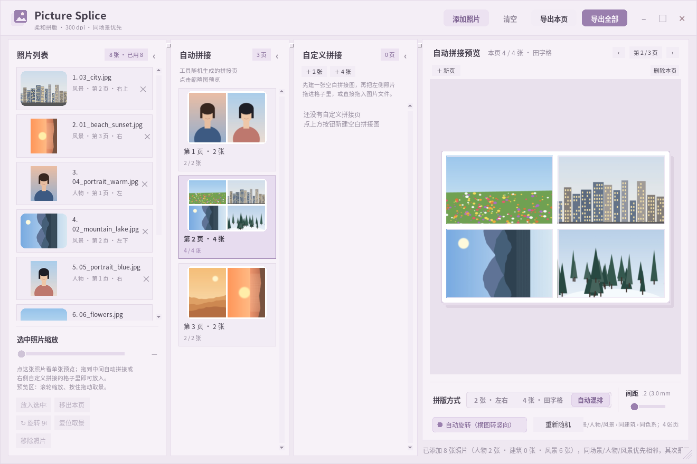

# Picture Splice

**六寸照片拼接工具** — 把多张照片自动拼成适合佳能 6 寸相纸打印的版面。

[](https://www.python.org/)
[](LICENSE)
[](#windows-桌面版)
[](#隐私与数据)
[](https://github.com/lingjin1618-eng/picture-splice/commits/main)
[](https://github.com/lingjin1618-eng/picture-splice/stargazers)

完全本地运行：**不联网、不上传照片、不修改原图**。支持 2 张左右版式 / 4 张田字格 / 自动混排，带智能分组、自动旋转、自定义拼版和后台导入导出，输出 1800 × 1200 px @ 300 dpi（3:2，约 15.24 × 10.16 cm）。



*界面预览（示例照片为生成的示意图）*

## 目录

- [功能亮点](#功能亮点)
- [运行](#运行)
- [Windows 桌面版](#windows-桌面版)
- [使用方法](#使用方法)
- [智能混排](#智能混排)
- [自动旋转](#自动旋转)
- [间距和边距](#间距和边距)
- [文件对话框](#文件对话框)
- [窗口操作](#窗口操作)
- [自动化规则](#自动化规则)
- [隐私与数据](#隐私与数据)
- [项目结构](#项目结构)
- [反馈与贡献](#反馈与贡献)
- [许可证](#许可证)

## 功能亮点

### 拼版与智能分组

- **2 张拼版**：左右各一张
- **4 张拼版**：田字格
- **自动混排（默认）**：每页随机使用 2 张或 4 张版式，4 张页面约占 1/4 ～ 1/3；也可以手动固定为 2 张或 4 张
- **智能分组**：自动混排时按优先级拼接——同一场景 / 人物 / 风景最优先，其次是同一建筑，最后按同色系兜底
- **自动旋转**：横图放进竖向格子（或竖图放进横向格子）时自动旋转 90°，避免被裁掉太多
- **自动分页**：一页放不下时自动新建下一页
- **可调参数**：照片间距、四周边缘留白

### 界面与操作

- **柔和浅色界面**：淡紫 + 藕粉配色，自绘圆角标题栏、药丸按钮、圆角相纸预览；最小化后会在右下角留下一个可点击恢复的小胶囊，窗口右下角可拖动缩放
- **三栏工作区**：从左到右依次是「单张照片」「自动拼接」「自定义拼接」，最右是大预览区。三栏都可以向左收起，也可以拖动分栏线调整宽度
- **单张预览**：点击左侧任意照片，右侧大图只预览这张单张照片
- **自动拼接列表**：中间一栏列出工具随机生成的所有拼接页，点击即可预览
- **自定义拼接列表**：右侧一栏初始为空，可以点「＋ 2 张」「＋ 4 张」建立空白拼接图；点击空白图后在预览区显示空白网格，再把左侧照片拖进格子里完成自己的拼版
- **两种拖入方式**：可以从左侧单张照片列表拖进格子；Windows 桌面版还可以直接从资源管理器把图片文件拖进空白拼接图
- **自由换图**：任意拼接页的格子都可以拖入照片替换
- **单张微调**：滚轮以光标为中心缩放、拖动取景（带残影拖尾）、手动旋转 90°、一键复位

### 导入与导出

- **后台导入**：导入在后台并行解码，窗口不会「未响应」；侧边栏实时显示「正在导入 x / N 张」进度条和百分比，可随时取消
- **原图质量**：导入时只在内存里缓存屏幕预览图，原文件不会被缩小或改写；导出时始终按原文件的全分辨率重新读取、用完整 LANCZOS 重采样拼接
- **导出**：可以 **导出本页**（只导出当前预览页）或 **导出全部**；JPEG（质量 98、无子采样）或 PNG，写入 300 dpi 信息；导出同样在后台进行，并显示页数进度
- **输出规格**：1800 × 1200 px，300 dpi，3:2（约 15.24 × 10.16 cm）

## 运行

### 获取代码

```bash
git clone https://github.com/lingjin1618-eng/picture-splice.git
cd picture-splice
```

### Linux / WSL

项目目录内已经准备好带中文显示的本地环境，直接运行：

```bash
./run.sh
```

如果环境不完整，或想在其他电脑上运行：

```bash
python3 -m pip install -r requirements.txt
python3 pic_splicer.py
```

### 环境要求

- Python 3.10+
- 系统自带 Tkinter
- Pillow >= 10
- `tkinterdnd2` 是可选依赖，只用于 Windows 下从资源管理器拖入图片；没安装时会自动禁用该功能，其他功能不受影响

> **中文显示**：Linux 上如果 Tk 是 conda 的 `noxft` 构建，中文会显示成 `\uXXXX`。请使用项目内的 `.venv`，或通过 `environment.yml` 创建带 Xft 的 Tk 环境。

## Windows 桌面版

项目可以打包成独立的 Windows 桌面程序 **Picture Splice**，双击运行，不需要安装 Python 或任何依赖（Windows 可执行文件的扩展名仍然是 `.exe`，文档里统一简称为 Picture Splice；在资源管理器里勾选「隐藏已知文件类型的扩展名」即可不显示后缀）。

目前仓库不提供预编译的 exe，需要按下面的步骤自行构建。重新构建（在 WSL 里执行）：

```bash
./build_windows.sh
```

- 需要 Windows 上装有 Python 3.10+（`py` 启动器可用）；第一次构建会自动安装 PyInstaller。
- `build_windows.sh` 是 WSL 入口，`build_windows.ps1` 负责调用 PyInstaller，`build_icon.py` 生成程序图标。
- 所有中间文件都放在 Windows 临时目录；Linux 下的源码、`run.sh` 和构建脚本都会保留，方便以后继续修改。
- exe 没有数字签名，个别系统首次运行时可能出现 SmartScreen 提示，选择「更多信息 → 仍要运行」即可。

## 使用方法

1. 点击右上角 **添加照片** 选择多张图片。照片会在后台并行解码，窗口保持响应；侧边栏会显示进度条和「正在导入 x / N 张」，导入结束后自动按场景分组并填入空格，放不下的会自动新建一页。导入途中可以点进度条右侧的 **取消**。
2. 最左侧「单张照片」列表显示所有照片，以及每张照片在自动拼接里的 **第几页 · 哪个位置**。每张卡片会标记「人物」或「风景」，显示「未使用」的照片还没有放进自动拼接页。**点击卡片**，右侧大图会变成这张单张照片的预览。
3. 中间「自动拼接」列表是工具随机生成的拼接页，**点击缩略图**即可在右侧预览。右侧「自定义拼接」列表初始是空的，点 **＋ 2 张** 或 **＋ 4 张** 建立空白拼接图；点击空白图后，预览区会显示带虚线空格的空白版面。
4. **拖照片进格子**：把最左侧的单张照片拖到右侧预览的任意格子里松手即可。
   - 拖到空格：照片放入该格。
   - 拖到已占用的格子：自动拼接页里两张照片交换位置；自定义拼接页里则替换该格。
   - 自定义拼接里的照片是独立副本，调整取景不会影响自动拼接页。
   - 也可以直接把照片拖到右侧自定义拼接栏里某张空白拼接图的缩略图上，会自动放进第一个空格。
   - Windows 桌面版还可以从资源管理器直接拖图片文件到预览区的格子或自定义拼接缩略图上；一次拖入多张时会依次填满空格，当前页放满后自动新建一张同样版式的空白拼接图。
   - 也可以先点右侧格子，再点左侧照片双击，或点「放入选中格」。
5. 三栏都可以点击标题右侧的 **‹** 向左收起，点收起后的 **›** 重新展开；拖动栏与栏之间的分栏线可以自由调整每一栏宽度。
6. 调整单张照片的取景：
   - 把鼠标移到右侧格子里，用 **滚轮** 即可放大/缩小这张照片（以光标位置为锚点）。
   - 在格子里 **按住拖动** 可以移动画面，拖动时会出现半透明残影，方便看清正在移动哪张。
   - 也可以用左下角的 **缩放** 滑块；点 **复位取景** 恢复 100% 居中。
7. 选中照片后点 **↻ 旋转 90°** 可以手动旋转；自动旋转由底部的复选框控制。
8. 在底部选择 **拼版方式**（默认是自动混排）：
   - **2 张 · 左右**
   - **4 张 · 田字格**
   - **自动混排**：每页随机 2 张或 4 张，4 张页面约占 1/4 ～ 1/3，点「重新随机」可以重新排一次。混排会先按人物 / 风景 / 建筑分类，再让同一场景、同建筑或同色系的照片相邻（详见下面的「智能混排」）。
9. 用 **间距** 和 **边距** 滑块调整留白。
10. 用预览区的 **＋ 新页 / 删除本页** 管理自动拼接页，用 **‹ / ›** 翻页；切到自定义拼接时，用最右栏的 **＋2 张 / ＋4 张** 新建空白页，用预览区的 **删除本页** 删除当前自定义拼接图。
11. 导出：
    - 点击 **导出本页**：只导出右侧预览里正在显示的那一张拼接图，选择保存路径，可保存为 JPEG 或 PNG；单张照片预览或空白拼接图不能导出。
    - 点击 **导出全部**：自动拼接页和自定义拼接图都会导出。
      - 只有一张拼接图时：选择保存路径，可保存为 JPEG 或 PNG。
      - 有多张时：选择文件夹，导出为 `六寸拼接_第01页_2张.jpg`、`自定义拼接_第01页_2张.jpg`…
      - 完全空着的页面不会被导出。

最左侧缩略图显示的是拼接前的单张照片（点击可单独预览）；中间显示工具自动拼接后的成品；右侧是用户自己新建的空白拼接图和成品。某一页不足 2 张或 4 张时，剩余位置在预览中显示为虚线空格；导出时是纯白背景。

> Windows 桌面版支持从资源管理器把图片文件直接拖进自定义拼接的格子；拖进来的照片也会同时出现在最左侧的单张照片列表里。Linux/WSL 下请先把照片用「添加照片」导入，再从最左侧列表拖入。

## 智能混排

自动混排和切换版式时会重新排序照片，优先级从高到低是：

1. **同一场景 / 人物 / 风景**：先是同一场景（同一机位、同一组连拍，感知哈希几乎重合）的照片；然后人物照聚在一起，通过肤色区域的占比、连通块大小和画面里的深色结构判断「像人像的照片」；风景照单独成组。
2. **同一建筑**：通过长直线（窗框、屋檐、墙面）和中性色比例识别建筑感，再把构图、明暗和色调相近的建筑照片串在一起。
3. **同色系兜底**：在风景组内优先用色相直方图分组（草原、沙漠、海边…），人物组和建筑组也把色调作为最后的相似度权重。

分组顺序固定为「人物 → 风景 → 建筑」。自动混排时每组分页会尽量只放同类照片，避免一页里人物、风景、建筑混杂；手动固定 2 张 / 4 张版式时，会按顺序连续填满页面，因此类别交界处可能有一页混合。每次「重新随机」会改变组内起始照片和近似候选之间的顺序，但不会把明显不同的类别或色系打散重排。

这套判断完全基于图像统计，**不需要联网，也不会上传照片**；它不等于人脸识别，也不识别具体建筑，无法真正分辨「是不是同一个人 / 同一栋楼」。光线、背景和颜色接近的画面可能被保守地归到不同类别，这时手动拖动替换即可。

## 自动旋转

工具会根据 **原图方向** 和 **格子方向** 决定是否旋转：

- 横图放进 2 张版式的竖向格子 → 自动转 90°，内容在纸上变成侧向，打印后把相纸转 90° 看即可，能比直接横放保留更多画面。
- 竖图放进 4 张版式的横向格子 → 同样自动转 90°。
- 方向本来就一致时不旋转。
- 不想自动旋转时，取消底部「自动旋转」复选框即可。
- 自动旋转后仍有内容方向问题（比如想上下颠倒），可以选中照片后连续点 **↻ 旋转 90°** 手动调整；自动旋转和手动旋转会叠加。

## 间距和边距

工具沿用了 Moldiv 的 12 档设置，默认 **间距 = 12，边距 = 12**。

当前换算方式：

```text
1 档 = 0.25 mm
12 档 ≈ 3.0 mm
```

界面上会同时显示换算后的毫米数。如果实际打印效果和 Moldiv 不一致，直接调大或调小滑块即可；例如需要 5 mm，可把数值设为 20。

## 文件对话框

主窗口是自绘的无边框窗口（`overrideredirect`），在 WSLg 下窗口管理器无法正确管理它，Tk 自带的文件对话框会被主窗口盖住。因此：

- **WSL**：调用 Windows 原生的打开 / 保存 / 选择文件夹对话框，永远显示在最前面；选中的 Windows 路径会自动转换成 `/mnt/c/...` 再读取。
- **Windows 和普通 Linux**：继续使用 Tk 自带的系统对话框。

## 窗口操作

- 顶部是自绘的浅色标题栏，按住任意空白处即可拖动窗口，双击标题栏可以最大化 / 还原。
- 右上角依次是最小化、最大化、关闭。
- 中间的三个列表栏可以拖动分栏线调整宽度；点每栏标题右侧的 **‹** 向左收起，再点收起栏里的 **›** 展开。
- 最小化后主窗口会隐藏，并在右下角留下一个「已最小化 · 点此恢复」的小胶囊，点击胶囊即可恢复窗口（这样不需要系统标题栏，也不会把浅色界面打断）。
- 窗口右下角的斜纹手柄可以拖动调整窗口大小。

## 自动化规则

- 每张照片自动按格子比例居中裁剪（cover 模式），不会拉伸变形。
- 照片缩放范围为 100%–300%。放大后才能拖动调整裁剪区域。
- 输出固定为 300 dpi 的 1800 × 1200 像素图，适合 6 寸相纸。
- **导入不改变原图**：内存里只保留一张最长边 1600 px 的界面预览图，原文件完全不动。拼接和导出时会重新打开原文件，按全分辨率裁剪、缩放。
- **导出质量**：JPEG 使用质量 98、无子采样（4:4:4）保存，并使用完整的 LANCZOS 重采样，不做降低质量的快速缩放；也可以导出 PNG 无损格式。
- 由于导出按原图重新读取，导入后请不要移动或删除原照片文件。
- 不支持 HEIC 文件，请先转换为 JPEG；彩色照片建议使用 sRGB 色彩空间。
- 人物/建筑/风景分类是肤色、直线结构和色彩统计的近似判断，不做人脸识别，也不上传照片。自动分组不满意时，直接拖动左侧照片替换，或点「重新随机」再排一次。

## 隐私与数据

- **完全离线**：程序不发起任何网络请求；照片分析（场景、人物、建筑、色系）全部在本机完成。
- **原图只读**：导入只读取文件生成界面预览，不会改写、移动或删除原照片。
- **只写导出位置**：除了导出时你选择的文件或文件夹，程序不在别处写图片。
- **无遥测**：没有账号、统计、崩溃上报或自动更新。

## 项目结构

```text
pic_splicer.py       主程序和拼接核心
run.sh               Linux / WSL 启动脚本（优先使用项目内 .venv）
build_windows.sh     WSL 下打包 Windows 桌面版并复制到桌面
build_windows.ps1    PyInstaller 打包脚本
build_icon.py        生成桌面版图标
requirements.txt     pip 依赖
environment.yml      可选的 conda 环境（带 Xft Tk）
docs/screenshot.png  README 界面截图
README.md            使用说明
PROJECT_SUMMARY.md   面向后续开发/升级的项目总结
LICENSE              MIT 许可证
.gitignore           忽略本地环境、构建产物和示例照片
```

## 反馈与贡献

- 遇到问题或有功能建议，欢迎提交 [Issue](https://github.com/lingjin1618-eng/picture-splice/issues)。
- 也欢迎提交 Pull Request；修改代码后请同步更新 `PROJECT_SUMMARY.md` 的版本记录。
- 如果这个工具帮到了你，点一个 ⭐ Star 就是最好的支持。

## 许可证

本项目采用 [MIT License](LICENSE) 开源。Copyright (c) 2026 lingjin1618-eng。
